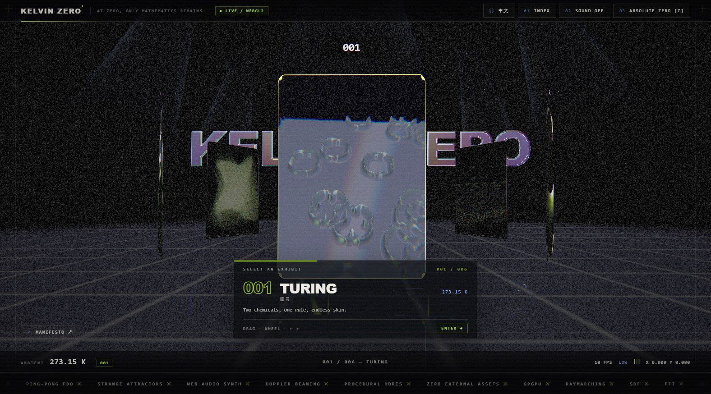
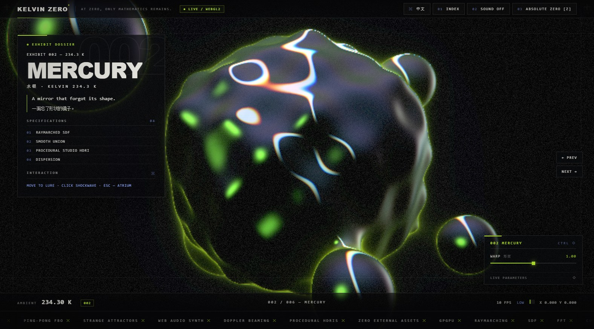
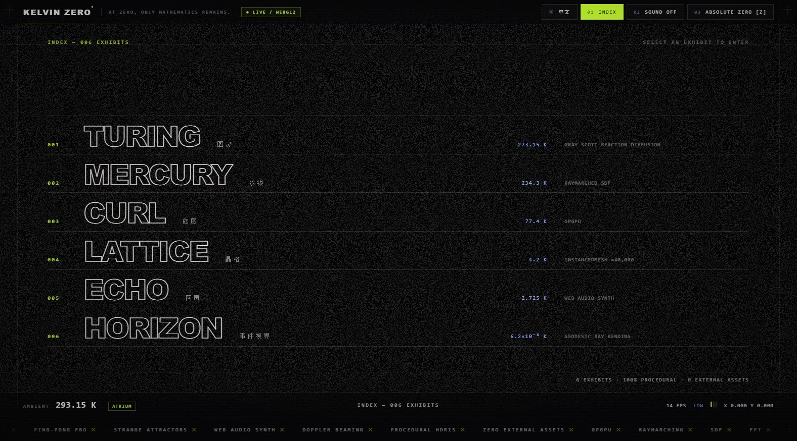

# KELVIN ZERO — A Gallery of Computed Phenomena

[](https://github.com/taozhihaoo/kelvin_zero/actions/workflows/ci.yml)
[](LICENSE)
[]()
[]()

> **A gallery of computed phenomena.** At zero, only mathematics remains.

An immersive digital gallery that exists only inside the GPU: an atrium, six
exhibits, an index page and a curatorial statement, all driven by a single
WebGL2 canvas and connected by a Voronoi frost-crystal transition. Every pixel
is generated procedurally — **no external images, videos, fonts, models, or
CDNs**.

**This is the default (English) README.** [中文版 → README.zh-CN.md](README.zh-CN.md)

---

## Screenshots

All screenshots below show the **English interface**.

### Atrium — the six-portal carousel



### Exhibit 002 MERCURY — dossier, parameter panel and navigation



### Index — all six exhibits



---

## Quick start

```bash
npm ci
npm run dev       # http://localhost:5173
npm run build     # production output in dist/
npm run preview   # serve the production build
```

Requirements: Node.js 18+ for development and builds; Node.js 22.6+ for the
test suite (`npm test` uses `--experimental-strip-types`, and the browser smoke
test uses the built-in `WebSocket` client). You also need a browser with WebGL2
(current Chrome, Edge, Firefox, or Safari). Sound is opt-in and starts only
after you click **ENTER GALLERY** or **SOUND**.

### URL options

| Parameter | Effect |
| --- | --- |
| `?lang=zh` | Start with the Chinese interface (default is English) |
| `?autoenter` | Skip the ENTER screen, used by automated browser tests |
| `?debug` | FPS overlay (needs the optional `stats.js` package) |
| `?warm=N` | Shorten the thumbnail warm-up to N frames (1–24), for screenshot runs |

Navigation uses hash routes: `#/`, `#/room/1` … `#/room/6`, `#/index`.
Back/forward navigation is supported.

## Interface language

The UI is bilingual by design: the primary language is shown large, with the
other language as a dimmed secondary label. **English is the default.** Click
the `中文 / EN` button in the top-right HUD, or open `?lang=zh`, to switch the
primary language to Chinese without reloading the WebGL scene. The language is
stored only in the URL query — no `localStorage`, no cookies.

## The six exhibits

Temperatures descend as you go deeper into the gallery.

| # | Exhibit | Temperature | Algorithm | Interaction |
| --- | --- | --- | --- | --- |
| 001 | TURING / 图灵 | 273.15 K | Gray–Scott reaction–diffusion on a GPU ping-pong pair (Du 1.0 / Dv 0.5 / dt 1.0, nine-point Laplacian); the v channel displaces a chrome heightfield with finite-difference normals | Drag to inject, `Space` to reset, `1`–`4` for spots/maze/coral/mitosis presets |
| 002 | MERCURY / 水银 | 234.3 K | 90-step raymarched SDF with low/high-frequency deformation, 5 smooth-union satellites, dispersion-reflected procedural studio environment | Move the pointer to lure a droplet, click for a shockwave |
| 003 | CURL / 旋度 | 77.4 K | `GPUComputationRenderer` position texture, up to 1024² = 1,048,576 particles; analytic curl-noise field and Aizawa / Thomas / Lorenz attractors | Pointer attracts, click bursts, `1`–`4` switches modes |
| 004 | LATTICE / 晶格 | 4.2 K | 200×200 = 40,000 `InstancedMesh` pillars displaced in the vertex shader by noise, radial standing waves, audio bass and 4 shockwave rings | Click shockwave, drag to orbit |
| 005 | ECHO / 回声 | 2.725 K | Web Audio pentatonic theremin (saw + sub-sine, 0.42 s delay); 128×64 FFT waterfall in a ring-buffered `DataTexture` rendered as occlusion-line terrain | Hold to play: X = pitch, Y = filter/volume; a synthetic spectrum demos the room when muted |
| 006 | HORIZON / 事件视界 | 6.2×10⁻⁸ K | 150-step approximate Schwarzschild geodesic integration (`dv = −1.5·rs·h²·p/r⁵·dt`), Doppler-beamed accretion disk, photon ring, lensed starfield | Drag to orbit, wheel for distance, sliders for mass/disk brightness |

The **ATRIUM** adds a canvas-to-mipmap liquid-chrome title, a six-portal
carousel with live thumbnails (only the hovered portal refreshes, at ~20 fps),
a `Reflector` mirror floor, six additive light beams and 2,000 dust motes.

## Controls

| Input | Action |
| --- | --- |
| Drag / wheel / `←` `→` | Rotate the atrium carousel (snaps to 60°); orbit the camera in exhibits |
| `Enter` / click the front portal | Enter the selected exhibit |
| `Esc` | Return to the atrium / close the manifesto |
| `Z` or `ABSOLUTE ZERO` | Time dilation to 0.02×, frost edges, temperature readout → `0.000 K`, muffled audio |
| `1`–`4` | Presets (TURING), modes (CURL) |
| `Space` | Reset the reaction–diffusion seed (TURING) |
| `INDEX`, `SOUND`, `LANG`, `MANIFESTO`, `PREV`, `NEXT` | HUD buttons; every control is keyboard reachable |

## Architecture

One renderer, one canvas, one `EffectComposer`. A custom `RoomPass`
(`needsSwap = false`) renders the active room — or a frost blend of two rooms —
into the read buffer, followed by `UnrealBloomPass`, a custom final shader
(chromatic aberration / vignette / grain / frost edges / scanlines) and
`OutputPass`.

| Concern | Files |
| --- | --- |
| SPA, hash routing, room lifecycle | `src/main.ts` · `src/core/router.ts` · `src/core/sceneManager.ts` · `src/rooms/room.ts` |
| Frost transition (dual RT + Voronoi) | `src/core/transition.ts` · `src/shaders/frost.frag.glsl` |
| Post-processing pipeline | `src/core/post.ts` · `src/shaders/final.frag.glsl` |
| GPGPU particles / ping-pong simulation | `src/rooms/curl.ts` · `src/rooms/turing.ts` · `src/core/pingpong.ts` · `src/shaders/curl.*.glsl` · `turing.*.glsl` |
| Raymarching / geodesics / instancing | `src/rooms/mercury.ts` · `horizon.ts` · `lattice.ts` · `src/shaders/mercury.frag.glsl` · `horizon.frag.glsl` · `lattice.*.glsl` |
| Web Audio synth + FFT waterfall | `src/audio/engine.ts` · `src/rooms/echo.ts` · `src/shaders/echo.*.glsl` |
| Chrome title, portals, mirror floor, beams, dust | `src/rooms/atrium.ts` · `src/shaders/chromeText.frag.glsl` · `portal.frag.glsl` · `grid.frag.glsl` · `beam.*.glsl` · `dust.*.glsl` |
| Shared GLSL (`studio()`, iridescence, noise) | `src/shaders/common.glsl` |
| HUD, dossier, selection card, panel, loader, manifesto, index | `src/ui/*.ts` · `src/style.css` · `index.html` |
| Design tokens, copy, exhibit metadata, timings | `src/config/*.ts` |
| Adaptive quality, clock, input, debug | `src/core/perf.ts` · `clock.ts` · `input.ts` · `debug.ts` |

## Scripts and CI

| Command | Description |
| --- | --- |
| `npm run typecheck` | `tsc --noEmit` |
| `npm test` | Node test runner: routing, exhibit data, quality tiers, i18n, shader-import integrity, docs/screenshot consistency |
| `npm run build` | Production bundle |
| `npm run verify:build` | Checks emitted assets, references and absence of external scripts |
| `npm run test:browser` | Headless Chrome/Edge CDP smoke test against the production build: boot, routes, dossier, panel, index, language switch, zero console errors |
| `npm run ci` | Runs the full chain above in one command |

`CPU_THROTTLE=8 npm run test:browser` throttles the renderer to simulate a slow
device and verifies that transitions still settle (GSAP lag smoothing is
disabled because WebGL frames can exceed 500 ms).

[`.github/workflows/ci.yml`](.github/workflows/ci.yml) runs on every push and
pull request to `main`: `npm ci` → typecheck → unit tests → build → artifact
verification → headless WebGL2 browser smoke test. The `dist/` bundle is
uploaded as a workflow artifact on every successful run. Set `CHROME_PATH` if
your Chrome/Chromium/Edge binary is not on `PATH`.

## Performance and graceful degradation

`src/core/perf.ts` samples a 60-frame average: >22 ms for 2 s steps down a
tier, <14 ms for 5 s steps up. Coarse pointers or ≤4 CPU cores start at
mid/low.

| Tier | Particles | Lattice | Reaction–diffusion | Render scale | Bloom / Reflector |
| --- | --- | --- | --- | --- | --- |
| high | 1024² | 200² | 512² × 8 steps | 0.75 | on / on |
| mid | 512² | 140² | 384² × 4 steps | 0.60 | on / on |
| low | 256² | 90² | 256² × 2 steps | 0.45 | off / off |

Mercury and HORIZON always render into a lower-resolution target and are
upscaled. `EXT_color_buffer_float` falls back to half-float. Without WebGL2 a
pure-DOM fallback page lists all six exhibits. `prefers-reduced-motion`
disables camera drift, idle rotation, marquee and grain animation, and shortens
transitions. `visibilitychange` pauses the loop; all render targets,
geometries, materials and event handlers are disposed on teardown.

## Accessibility

Semantic `header` / `main` / `footer`, a skip link, labelled buttons,
`aria-live` regions, full keyboard navigation, visible focus outlines,
`Esc` to dismiss overlays, and all exhibit copy retained in the DOM. The
WebGL canvas is decorative (`aria-hidden`). Both interface languages are
available for screen-reader users.

## Security

See [SECURITY.md](SECURITY.md). KELVIN ZERO has no backend, no accounts, no
analytics, no network requests and no `localStorage` usage; all content is
generated procedurally at runtime. Please report vulnerabilities privately
through a GitHub Security Advisory rather than a public issue.

## License

MIT — see [LICENSE](LICENSE). Third-party runtime dependencies:
`three@0.170.0` (MIT) and `gsap` (standard "no charge" license); development
tooling: Vite (MIT), TypeScript (Apache-2.0). Each dependency keeps its own
license in `node_modules` after installation.
