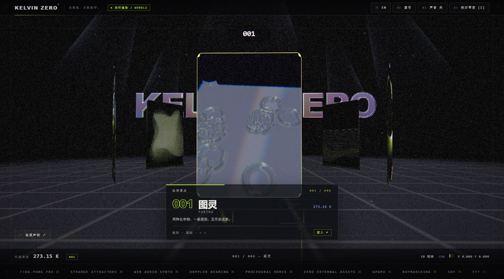
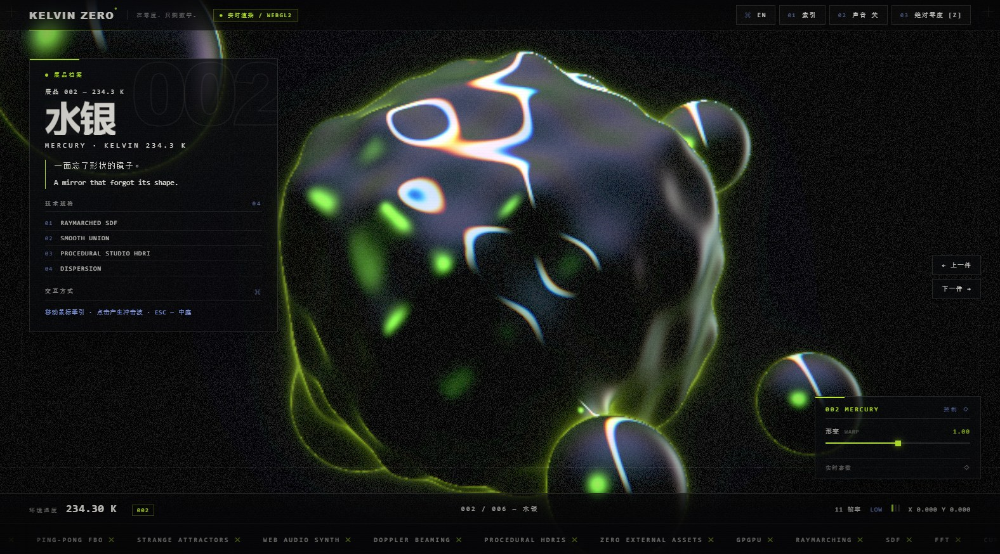
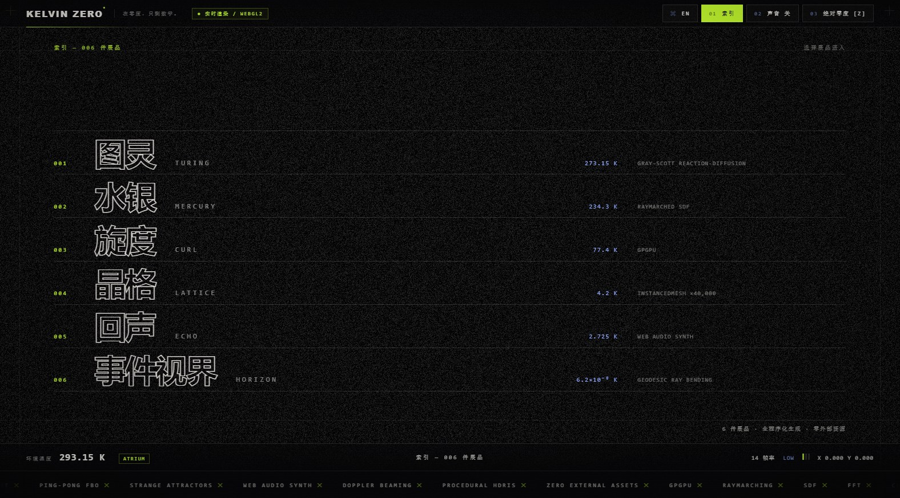

# KELVIN ZERO — 零度美术馆

[](https://github.com/taozhihaoo/kelvin_zero/actions/workflows/ci.yml)
[](LICENSE)
[]()
[]()

> **一座陈列「被计算出来的现象」的美术馆。** 在零度，只剩数学。

一座只存在于 GPU 中的数字美术馆：中庭、六个展厅、索引页与策展声明，全部由同一个
WebGL2 画布驱动，以 Voronoi 霜冻结晶转场相连。所有画面均为程序化生成——
**零外部图片 / 视频 / 字体 / 模型 / CDN**。

**默认文档为英文版 [README.md](README.md)**；本文件是中文版。

---

## 界面截图

以下截图均为**中文界面**。

### 中庭 — 六门户环形展架



### 展厅 002 水银 — 展品档案、参数面板与前后导航



### 索引 — 六件展品



---

## 快速开始

```bash
npm ci
npm run dev       # http://localhost:5173
npm run build     # 产物在 dist/
npm run preview   # 预览生产构建
```

环境要求：开发与构建需要 Node.js 18+；测试套件需要 Node.js 22.6+
（`npm test` 使用 `--experimental-strip-types`，浏览器冒烟测试使用内置
`WebSocket` 客户端）。另需支持 WebGL2 的浏览器（最新版 Chrome / Edge /
Firefox / Safari）。声音默认关闭，点击 **进入美术馆** 或 **声音** 按钮后才启动。

### URL 参数

| 参数 | 作用 |
| --- | --- |
| `?lang=zh` | 以中文界面启动（默认英文） |
| `?autoenter` | 跳过 ENTER 启动页，供自动化浏览器测试使用 |
| `?debug` | FPS 浮层（需自行安装可选依赖 `stats.js`） |
| `?warm=N` | 将缩略图预热帧数缩短为 N（1–24），用于截图 |

路由为 hash 形式：`#/`、`#/room/1` … `#/room/6`、`#/index`，支持浏览器前进后退。

## 界面语言

界面采用双语排版：主语言大字号显示，另一语言作为低透明度副标。**默认英文**。
点击右上角 HUD 的 `中文 / EN` 按钮，或使用 `?lang=zh`，即可把主语言切换为中文，
无需重新加载 WebGL 场景。语言状态只保存在 URL 查询参数中——不使用
`localStorage`，不使用 Cookie。

## 六个展厅

越深入，温度越低。

| 编号 | 展厅 | 温度 | 算法 | 交互 |
| --- | --- | --- | --- | --- |
| 001 | TURING / 图灵 | 273.15 K | GPU ping-pong 上的 Gray–Scott 反应扩散（Du 1.0 / Dv 0.5 / dt 1.0，九点拉普拉斯核）；v 通道驱动铬质高度场，片元用有限差分求法线 | 拖动注入、`Space` 重置、`1`–`4` 切换 spots/maze/coral/mitosis 预设 |
| 002 | MERCURY / 水银 | 234.3 K | 90 步光线步进 SDF，低频/高频形变、5 颗 smooth-union 卫星珠、程序化摄影棚环境的色散反射 | 移动鼠标牵引水银珠，点击产生冲击波 |
| 003 | CURL / 旋度 | 77.4 K | `GPUComputationRenderer` 位置纹理，最多 1024² = 1,048,576 粒子；解析旋度噪声场与 Aizawa / Thomas / Lorenz 奇异吸引子 | 鼠标吸引、点击爆发、`1`–`4` 切换模式 |
| 004 | LATTICE / 晶格 | 4.2 K | 200×200 = 40,000 个 `InstancedMesh` 柱体，顶点着色器叠加噪声、径向驻波、音频低频与 4 通道冲击波环 | 点击冲击波，拖动环绕 |
| 005 | ECHO / 回声 | 2.725 K | Web Audio 五声音阶特雷门琴（saw + sub-sine，0.42 s 延迟）；128×64 FFT 瀑布写入环形缓冲 `DataTexture`，绘制成遮挡线地形 | 按住发声：X 控制音高，Y 控制滤波/音量；静音时用合成频谱演示 |
| 006 | HORIZON / 事件视界 | 6.2×10⁻⁸ K | 150 步近似 Schwarzschild 测地线积分（`dv = −1.5·rs·h²·p/r⁵·dt`）、多普勒增亮吸积盘、光子环、引力透镜星空 | 拖动环绕，滚轮改变距离，滑块调节质量/盘亮度 |

**中庭 ATRIUM** 另含：Canvas → mipmap 高度 → 液态铬字标题；六门户转盘（只有被悬停的门户
以约 20 fps 实时刷新缩略图）；`Reflector` 镜面地面；6 道加法混合光束；2000 颗尘埃粒子。

## 操作方式

| 输入 | 动作 |
| --- | --- |
| 拖动 / 滚轮 / `←` `→` | 旋转中庭转盘（吸附到 60°）；在展厅中环绕相机 |
| `Enter` / 点击正前方门户 | 进入所选展厅 |
| `Esc` | 返回中庭 / 关闭策展声明 |
| `Z` 或「绝对零度」 | 时间缩放至 0.02×、霜冻边缘、温度读数归 `0.000 K`、音频变闷 |
| `1`–`4` | 图案预设（图灵）、 attractor 模式（旋度） |
| `Space` | 重置反应扩散种子（图灵） |
| `索引`、`声音`、`语言`、`策展声明`、`上一件`、`下一件` | HUD 按钮，全部可键盘访问 |

## 架构

单 renderer、单画布、单 `EffectComposer`。自定义 `RoomPass`
（`needsSwap = false`）把当前展厅（或霜冻混合中的两个展厅）渲染进 read buffer，
随后依次经过 `UnrealBloomPass`、自定义最终着色器（色散 / 暗角 / 颗粒 /
霜冻边缘 / 扫描线）与 `OutputPass`。

| 模块 | 文件 |
| --- | --- |
| SPA、hash 路由、展厅生命周期 | `src/main.ts` · `src/core/router.ts` · `src/core/sceneManager.ts` · `src/rooms/room.ts` |
| 霜冻转场（双 RT + Voronoi） | `src/core/transition.ts` · `src/shaders/frost.frag.glsl` |
| 后处理管线 | `src/core/post.ts` · `src/shaders/final.frag.glsl` |
| GPGPU 粒子 / ping-pong 模拟 | `src/rooms/curl.ts` · `src/rooms/turing.ts` · `src/core/pingpong.ts` · `src/shaders/curl.*.glsl` · `turing.*.glsl` |
| 光线步进 / 测地线 / 实例化 | `src/rooms/mercury.ts` · `horizon.ts` · `lattice.ts` · `src/shaders/mercury.frag.glsl` · `horizon.frag.glsl` · `lattice.*.glsl` |
| Web Audio 合成 + FFT 瀑布 | `src/audio/engine.ts` · `src/rooms/echo.ts` · `src/shaders/echo.*.glsl` |
| 铬字、门户、镜面地面、光束、尘埃 | `src/rooms/atrium.ts` · `src/shaders/chromeText.frag.glsl` · `portal.frag.glsl` · `grid.frag.glsl` · `beam.*.glsl` · `dust.*.glsl` |
| 公共 GLSL（`studio()`、虹彩、噪声） | `src/shaders/common.glsl` |
| HUD、展品档案、信息卡、参数面板、Loader、策展声明、索引页 | `src/ui/*.ts` · `src/style.css` · `index.html` |
| 设计变量、文案、展厅数据、动效时长 | `src/config/*.ts` |
| 自适应画质、时钟、输入、调试 | `src/core/perf.ts` · `clock.ts` · `input.ts` · `debug.ts` |

## 脚本与 CI

| 命令 | 说明 |
| --- | --- |
| `npm run typecheck` | `tsc --noEmit` |
| `npm test` | Node 测试：路由、展厅数据、画质分档、i18n、GLSL 引用完整性、文档/截图一致性 |
| `npm run build` | 生产构建 |
| `npm run verify:build` | 校验产物、资源引用、无外部脚本 |
| `npm run test:browser` | 无头 Chrome/Edge CDP 冒烟测试：启动、路由、档案、面板、索引、语言切换、零控制台错误 |
| `npm run ci` | 一次跑完以上全部步骤 |

[`.github/workflows/ci.yml`](.github/workflows/ci.yml) 在 `main` 分支的每次 push 与 PR 上运行：
`npm ci` → 类型检查 → 单元测试 → 构建 → 产物校验 → 无头 WebGL2 浏览器冒烟测试。
构建成功后会上传 `dist/` 作为工作流产物。若浏览器不在 `PATH` 中，请设置
`CHROME_PATH`。

## 性能与降级

`src/core/perf.ts` 统计最近 60 帧均值：连续 2 秒 >22 ms 降档，连续 5 秒 <14 ms 升档。
触屏设备或 CPU ≤4 核从 mid/low 起步。

| 档位 | 粒子数 | 晶格 | 反应扩散 | 渲染比例 | Bloom / Reflector |
| --- | --- | --- | --- | --- | --- |
| high | 1024² | 200² | 512² × 8 步 | 0.75 | 开 / 开 |
| mid | 512² | 140² | 384² × 4 步 | 0.60 | 开 / 开 |
| low | 256² | 90² | 256² × 2 步 | 0.45 | 关 / 关 |

水银与黑洞始终先渲染到低分辨率 RT 再放大；`EXT_color_buffer_float` 不可用时自动回退
半浮点。缺少 WebGL2 时展示纯 DOM 降级页，列出六件展品。
`prefers-reduced-motion` 会关闭相机漂移、空闲自转、跑马灯与颗粒动画并缩短转场。
`visibilitychange` 暂停主循环；所有 RT、几何体、材质与事件监听在卸载时释放。

## 无障碍

语义化 `header` / `main` / `footer`、跳转链接、带标签的按钮、`aria-live` 区域、
完整键盘操作、可见焦点框、`Esc` 关闭浮层，全部展厅文案保留在 DOM 中。
WebGL 画布为装饰性元素（`aria-hidden`）。读屏用户可切换两种界面语言。

## Security

See [SECURITY.md](SECURITY.md). KELVIN ZERO has no backend, no accounts, no
analytics, no network requests and no `localStorage` usage; all content is
generated procedurally at runtime. Please report vulnerabilities privately
through a GitHub Security Advisory rather than a public issue.

## License

MIT — see [LICENSE](LICENSE). Third-party runtime dependencies:
`three@0.170.0` (MIT) and `gsap` (standard "no charge" license); development
tooling: Vite (MIT), TypeScript (Apache-2.0). Each dependency keeps its own
license in `node_modules` after installation.
